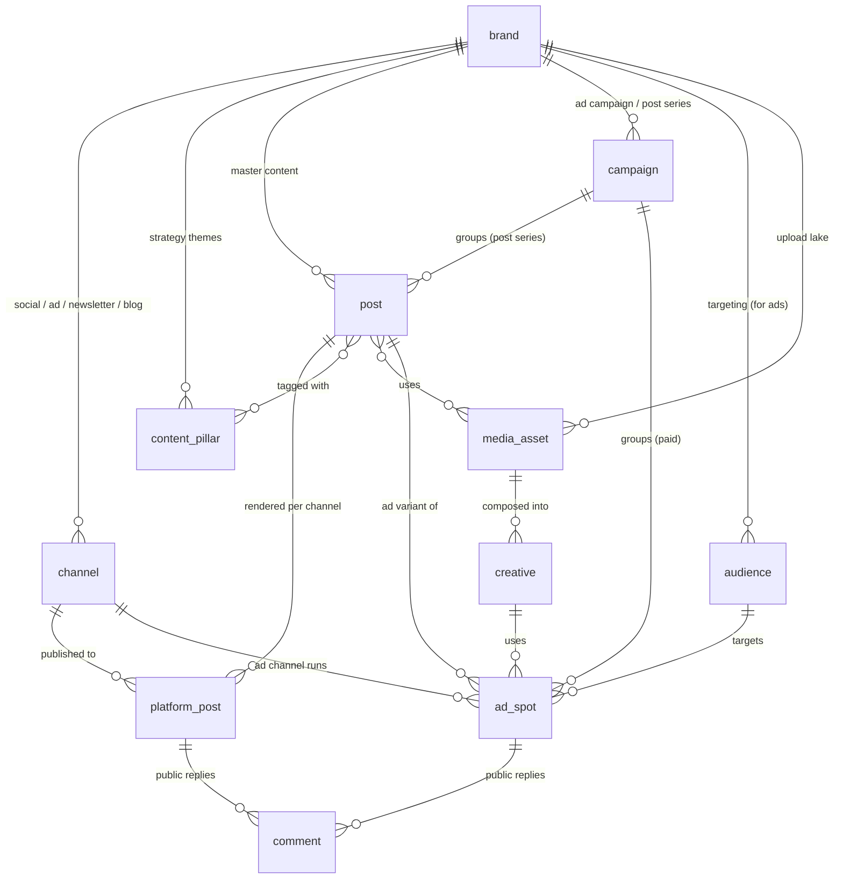

# Brand → Content & Ads — relationship map (for design)

Scope: the **publish/forge core** — how a brand connects to its channels, posts, ads,
campaigns and audiences. This is the slice we want to mock up. (Listening, lifecycle,
websites, identity/billing are out of scope here.)

Terminology note — three things that sound alike but aren't:
- **Post** = the *master content idea* (written once).
- **Platform spot** (`platform_post`) = that post *rendered for one channel* (the actual tweet / IG post / newsletter issue / blog post).
- **Ad spot** (`ad_spot`) = a *paid placement* — a creative shown to an audience on an ad channel.

---

## The map

Cardinality key: `||--o{` = one-to-many · `}o--o{` = many-to-many.

---

## What each thing is (glossary for the designer)

| Entity | In plain words | Key things to show | Who creates it |
|---|---|---|---|
| **brand** | The thing being marketed. Owned (Wander, WanderOS, a founder) or a tracked competitor. | logo, name, type (company/personal), tagline, voice, follower total | human |
| **channel** | A connected account you publish to. Grouped in UI as **social**, **ad**, **newsletter**, **blog**. | platform icon, handle, connection status (connected / needs-reconnect / error), followers | human (connect) |
| **content_pillar** | A recurring strategy theme posts are organized under. | name, color, description, target cadence | human, AI-suggested |
| **post** | The master content idea — written once, before it's adapted per channel. | title/hook, draft body, pillar(s), status, author, target date | human first, AI drafts later |
| **platform_post** (*platform spot*) | The post rendered for **one** channel — the real tweet / IG post / newsletter issue / blog post. Also holds **scraped** posts (yours or competitors'). | channel, rendered text, media, status (draft/scheduled/published), source (made/scraped), publish time, **inline stats** (likes/comments/shares/views), link | human/AI (made) or scraper |
| **comment** | A public reply on a platform spot or ad spot. Important for engagement. | author, text, sentiment, time, replied? | external |
| **campaign** | A grouping. Two flavors: a **post series / thread** (organic) or an **ad campaign** (paid). | name, kind, objective, date range, budget (if paid) | human |
| **ad_spot** (*ad spot*) | A single paid placement: a creative shown to an audience on an ad channel. | channel, creative, audience, campaign, status, **spend**, **inline stats** (impressions/clicks/conv.), flight dates | human, AI-assisted |
| **audience** | A targeting definition for ads. | name, definition (demo/interest/custom), est. size, platform | human |
| **creative** | The visual/asset built for an ad (composed from media). | preview, format (image/video/carousel), variant label | human/AI |
| **media_asset** | The raw upload lake — images/videos reused across posts and creatives. | thumbnail, type, dimensions, tags | human/AI |

> Cross-cutting on the content rows: **`status`** (draft → pending_review → approved → published) and **`origin`** (human vs AI). These drive review/approval UI. Stats and spend are stored **inline** on the spot (latest snapshot), not in a separate table.

---

## Relationships in words

**A brand owns** its channels, pillars, posts, campaigns, audiences, and media.

**Organic flow (the left half):**
- One **post** → many **platform spots** (one per channel it's published to). The post is the idea; the spots are the per-channel renderings.
- A **post** is tagged with one or more **pillars** and can use **media assets**.
- A **channel** accumulates many **platform spots** over time (its feed).
- A **platform spot** collects **comments**.

**Paid flow (the right half):**
- A **post** can spawn **ad spots** (turn organic content into an ad) — but an ad spot can also be standalone.
- An **ad spot** runs a **creative**, targets an **audience**, on an **ad channel**, and collects **comments** + **spend**.
- A **creative** is composed from **media assets**.

**Campaigns straddle both:** a campaign groups either **posts** (a content series/thread) or **ad spots** (a paid push) — same entity, `kind` tells them apart.

---

## Screen-grouping ideas (just a starting point — break up as needed)

Three natural lenses on the same data. Could be **one brand workspace with tabs**, or split into separate screens as it grows:

1. **Channels** — the "where." Social + ad channels for the brand, connection health, follower counts. (This is the cluster your `/app` overview mockup already shows per brand.)
2. **Content** — the "what, organic." Posts and their platform spots, viewed as a **feed** (list) or **calendar** (timeline), filterable by pillar/channel/status. Comments + stats inline.
3. **Ads** — the "what, paid." Campaigns → ad spots, with their audiences, creatives, spend, and results.

**campaign** appears in both Content (as post-series) and Ads (as ad-campaign), so it's the natural bridge if you want a combined view. **media_asset** underlies both (a library/picker), and **pillar** is the organizing axis for Content.
