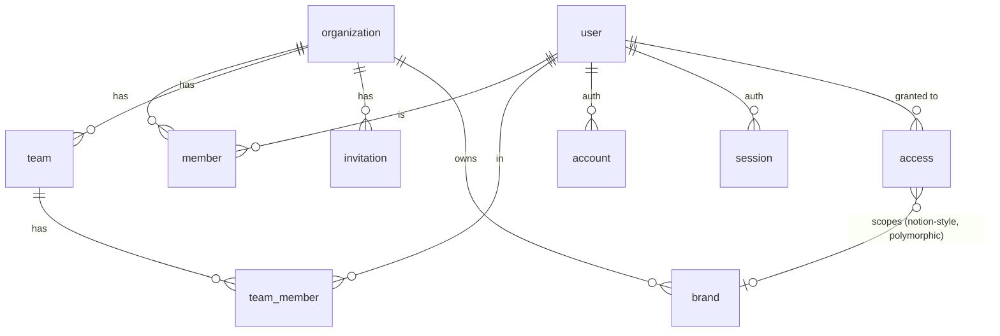
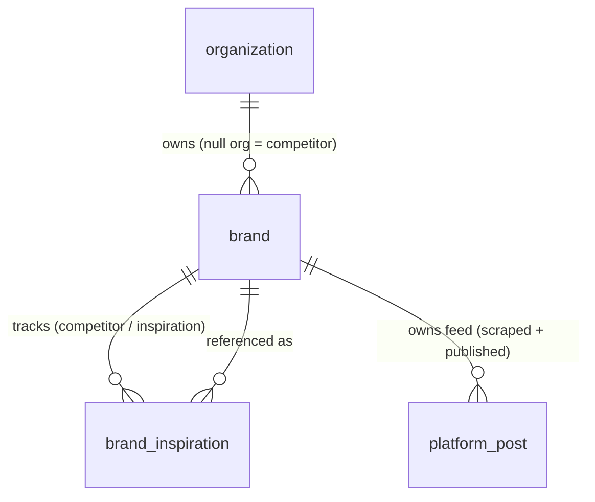
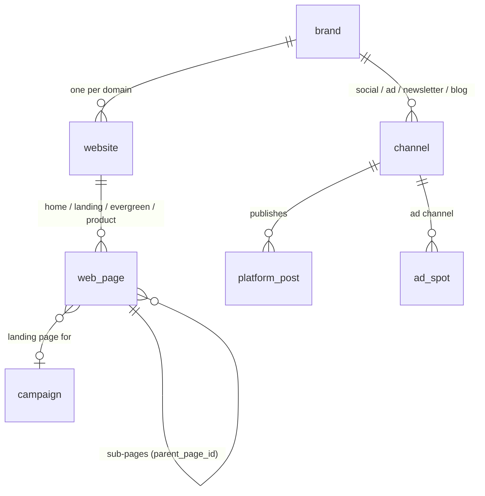
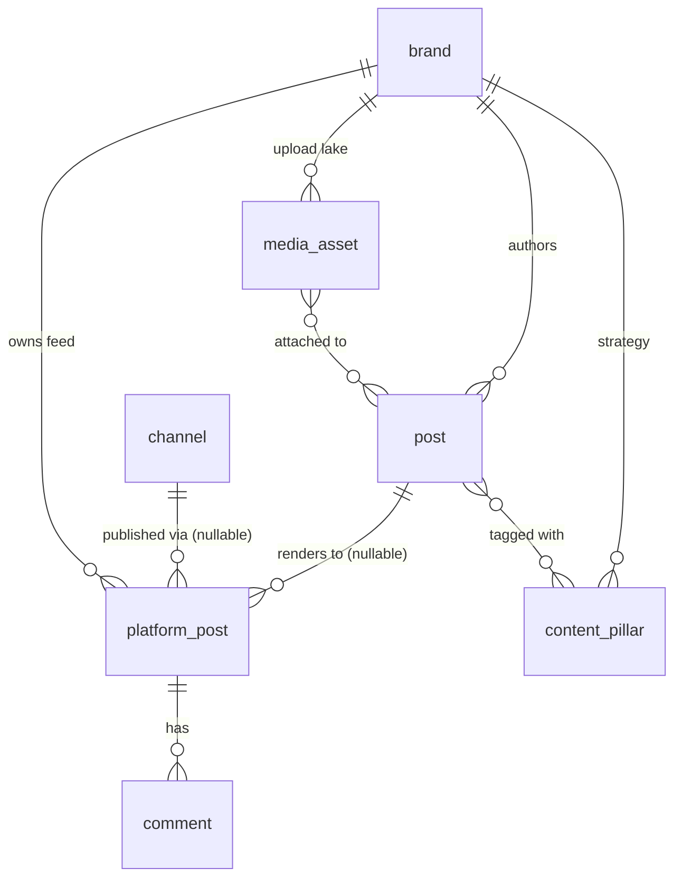
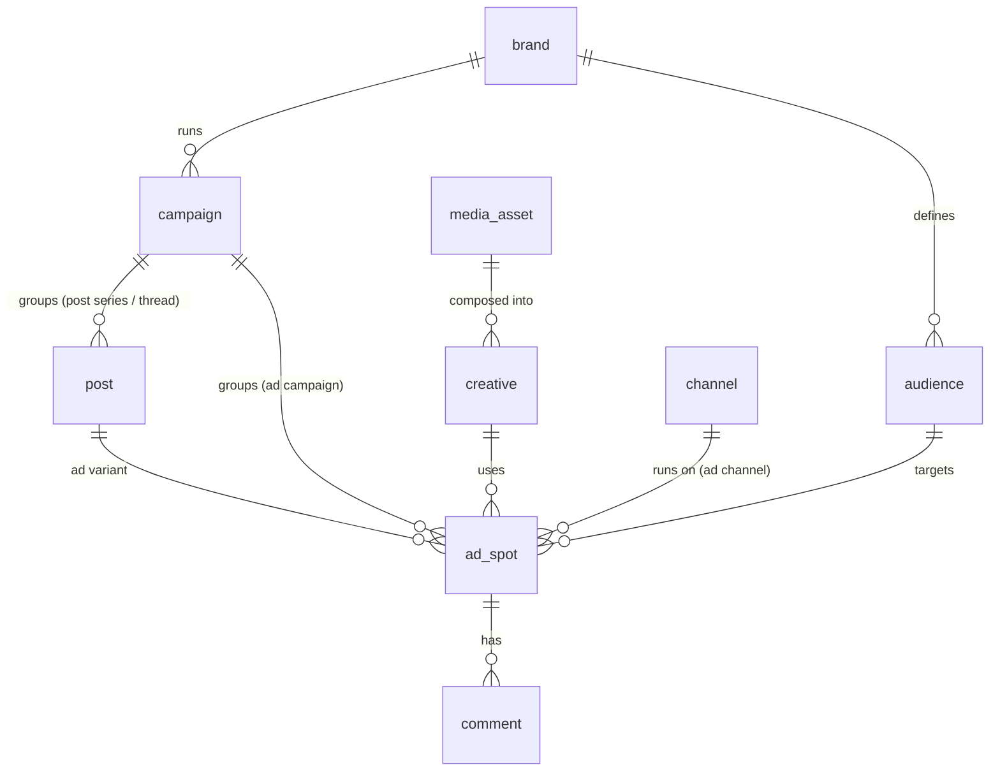
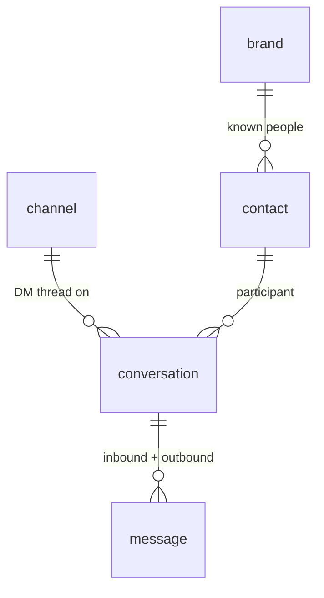
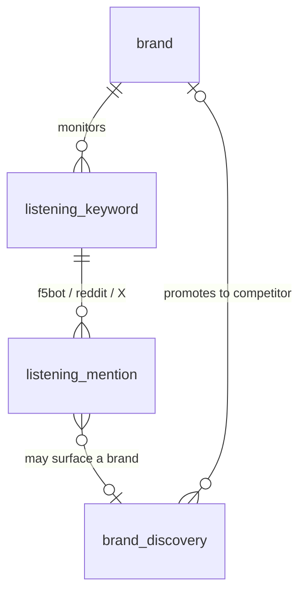
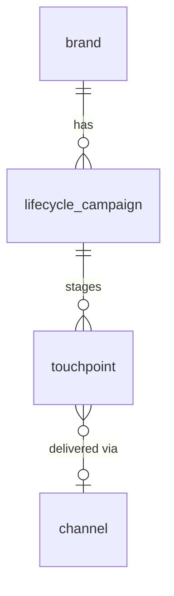

# Growth back-office — data model (working draft)

> **Status: throwaway scaffolding.** This file exists to settle entity shapes and
> relationships fast. Once the shape feels right we lift it into a real Drizzle
> `brand-schema.ts`, point a generator (drizzle-lab / Atlas) at it, and **delete this file**.
> The single combined diagram lives in `data-model.mmd`; this file adds the prose.

## How to read this

- `||--o{` one-to-many · `||--o|` one-to-(zero|one) · `}o--o{` many-to-many · `}o--||` many-to-one
- Preview locally: `bierner.markdown-mermaid` in VS Code/Cursor (`Cmd+Shift+V`), or paste a block into mermaid.live.

### Cross-cutting conventions (shown as columns later)

- **`origin`** = `human | ai` — humans create first; AI discovery writes later, never silently.
- **`status`** = `draft | discovered | pending_review | approved | rejected | published` — AI writes to `pending_review`, a human promotes to `published`.
- **stats live inline** — engagement `stats` (and `spend` on ads) are JSONB columns on `platform_post` / `ad_spot`, not a separate table (§6).
- **mirror-live-first** — for v1 a surface may render directly from an external API on page load and persist nothing (DMs via Zernio, some analytics). We only persist what we need to *forge on* or *trend over time*.
- soft delete (`deleted_at`) + timestamps everywhere, per the Jetpack convention.

### The two content primitives (this resolves most "where does X go?" questions)

- **`channel`** = a **stream** of time-series content you publish to (social platform, newsletter, blog). Content = `post → platform_post`, flows through /feed + /calendar.
- **`web_page`** = a **persistent page** with a stable URL on a `website` (home, landing, evergreen, product). SEO/analytics surface, not time-series content.
- Tell them apart: *a stream of dated posts → channel; a page with a stable URL → web_page.*

---

## 1. Identity & access

- `organization` is mostly a billing middleman; real work hangs off `brand`.
- `access` = Notion-style resource grants. Polymorphic target (brand today, others later).

---

## 2. Brand core (collapsed from native's split)

- **One `brand` table**, **nullable `organization_id`**: set = owned brand; null = reference/competitor.
- `brand.type` = `company | personal`. A personal brand is just `type=personal` with no ad channels (no special-casing — see the `/app` mockup).
- **`brand_inspiration` is a self-referencing junction** (`brand_id → inspiration_brand_id`, **`purpose = competitor | inspiration`**, `notes`). Many-to-many so one Airbnb row can be "ref by Wander · WanderOS" — dedup without duplicate rows.
- Owned-only tables (campaign, content_pillar, audience, lifecycle, OAuth channels) FK to `brand`; never created for competitor rows. Guard "my brands" queries with `organization_id IS NOT NULL`.
- Posts populate by **`source`**, not ownership — competitor → `scraped`, yours → usually `published` but **may also be `scraped`**.

> **Why collapse native's `brand`/`brand_profile` split?** It was an *unfinished migration*, not a proven decision: `brand-schema.ts` is untracked, `platform_post` is referenced nowhere, `brand_inspiration.router.ts` is a stub of TODOs, and every running service uses `brandTable` + JSONB. We take the cleaner endpoint and keep the one real benefit (competitor dedup) via the junction.

---

## 3. Channels, websites & pages

- **`channel.kind`** = `social | ad | newsletter | blog`; `platform` = `linkedin | instagram | x | facebook | youtube | tiktok | google_ads | meta_ads | chatgpt_ads | ...` + handle + `connection_status`.
  - **Newsletter is a channel** (`kind=newsletter`); an issue is a `platform_post`. Break out later if needed.
  - **Blog is a channel** (`kind=blog`); a blog post is a `post → platform_post` (editorial workflow, /feed, /calendar). Break into its own table only when MDX/SEO richness demands it.
- **`website`** = one per domain (wander.com; os.wander.com is separate — see mockup).
- **`web_page.type`** = `home | search | property | checkout | landing | evergreen | blog_index | other`, with **self-referencing `parent_page_id`** for hierarchy:
  - `home / search / property / checkout` — product pages (tracked for SEO/analytics, not authored by growth)
  - `landing` — /list, /os, /travel-agents — conversion pages; optional FK to a `campaign`
  - `evergreen` — /california — programmatic/templated; **the future Wander Sites programmatic-generation project plugs in here**
  - `blog_index` — the /blog listing page (the *posts* are channel content; the index is a page)

---

## 4. Content (the spine)

- `post` = master content idea. `platform_post` = the per-channel rendering — **covers social posts, newsletter issues, and blog posts alike.**
- **`platform_post` unifies cases** via nullable FKs + `source`:
  - competitor scraped → `post_id` null, `brand_id` = competitor, `source = scraped`
  - your history scraped → `post_id` null, `brand_id` = self, `source = scraped`
  - your published → `post_id` = master, `channel_id` = channel, `source = published`
- `comment` (public, post-anchored) is first-class — on `platform_post` and `ad_spot`. Distinct from DMs (§7).

---

## 5. Ads & creative

- `campaign.kind` = `ad_campaign | post_series` — covers paid campaigns and plain series/threads. Can also back a `landing` `web_page`.
- `ad_spot` ≈ `platform_post` for paid: tied to an `audience`, a `creative`, and an ad `channel`.

---

## 6. Results & analytics — inline for v1

No `metric` table yet. **Latest `stats` (and `spend` on ads) live as JSONB columns directly on `platform_post` and `ad_spot`** (newsletter issues + blog posts are `platform_post`s, so they're covered). `web_page` carries inline traffic stats too.

- Trade-off: inline = *latest snapshot only*; re-sync overwrites, so no history/time-series.
- **When the dedicated results schema lands**, add a time-series `metric_snapshot` table referencing those rows; the inline value becomes the "latest" cache. `spend` (daily) graduates first.

---

## 7. Direct messages (private inbox — distinct from comments)

- A **comment** is public + post-anchored; a **DM** is private + thread/person-anchored. Different shapes → different tables.
- **v1: render live from Zernio on page load, persist nothing** (the mirror-live-first principle). This DB structure is the "when we own it" target.
- `message.direction` = `inbound | outbound`. `contact` overlaps the Outreach/CustomerIO prospect data this repo already syncs — decide own vs mirror before persisting.
- Possible future unification: one `interaction` table (`kind = comment | dm | mention`, `direction`) merging comments + listening mentions + DMs. Resist until all three are concrete.

---

## 8. Listening & discovery

- On-demand queries first; cron + draft replies later.
- `brand_discovery` bridges a raw mention to a tracked competitor `brand` (org-null).

---

## 9. Lifecycle

- `lifecycle_campaign.kind` = `onboarding | abandoned_cart | reactivation | revival`.
- Mostly mirrors CustomerIO/Amplitude — a view-only state machine to start.

---

## Open questions

1. ~~Competitors reuse the brand model?~~ **Resolved:** one `brand` table, nullable org, self-referencing `brand_inspiration`.
2. ~~Metric table vs inline?~~ **Resolved:** inline for v1; time-series table with the results schema.
3. ~~Keep native's `brand_profile` split?~~ **Resolved:** no — collapsed (unfinished migration).
4. ~~Website / blog modeling?~~ **Resolved:** blog & newsletter are `channel`s; `web_page` holds persistent pages (home/landing/evergreen/product) with `parent_page_id` hierarchy.
5. ~~Newsletter = channel?~~ **Resolved:** yes — `channel(kind=newsletter)`, issue = `platform_post`.
6. **DM ownership** — own the inbox or mirror/integrate Outreach/CIO? (v1 = mirror live from Zernio.)
