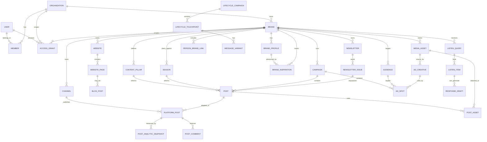
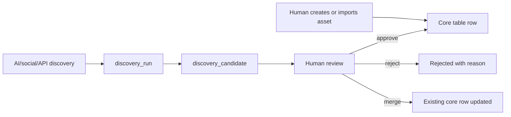

# Growth Product Architecture Map

Working map for the brand, content, lifecycle, listening, and growth-ops system.
This is intentionally a planning artifact, not a migration spec.

## Product Shape

The app is becoming a command center for brands and their growth surface area:
content strategy, channels, posts, ads, media, newsletters, lifecycle campaigns,
social listening, people, competitors, analytics, and external apps.

Two principles should guide the build:

1. Create database assets first, then enhance them.
2. Start with human mutations, then add AI discovery with human approval or rejection.

That means the first useful version should let a human create brands, channels,
websites, content pillars, campaigns, media, posts, audiences, and listening
queries. AI should initially write candidates into review tables, not mutate
core records directly.

## Page Map

Assume these live under `/app` unless noted.

```mermaid
flowchart TD
  Home["/app\nDashboard and quick links"]

  Home --> Pillars["/app/pillars\nStrategy, tone, content pillars"]
  Home --> Brands["/app/brands\nWander, WanderOS, people brands"]
  Home --> Channels["/app/channels\nOrganic and paid channel inventory"]
  Home --> Calendar["/app/calendar\nFuture and historical schedule"]
  Home --> Feed["/app/feed\nVisual inspection across posts and ads"]
  Home --> Campaigns["/app/campaigns\nCampaigns, post series, threads, ad campaigns"]
  Home --> Media["/app/media\nUpload lake and asset library"]
  Home --> Studio["/app/studio\nRemix media, old posts, and new drafts"]
  Home --> Blog["/app/blog\nBrand/site blog entries and post analytics links"]
  Home --> Newsletters["/app/newsletters\nTopics, issues, drafts, sends"]
  Home --> Seasons["/app/seasons\nSeasonal wheel, holidays, stories, reviews"]
  Home --> Lifecycle["/app/lifecycle\nCampaigns, touchpoints, state-machine view"]
  Home --> Apps["/app/apps\niOS, Android, ChatGPT apps, extensions"]
  Home --> News["/app/news\nPress, backlinks, mentions"]
  Home --> People["/app/people\nGrowth team and important company people"]
  Home --> Listen["/app/listen\nF5Bot, Reddit, X, keywords, draft replies"]
  Home --> Canvas["/app/canvas\nInfinite brand map, later"]

  Brands --> BrandDetail["/app/brands/[brandId]\nBrand home"]
  BrandDetail --> BrandPillars["/app/brands/[brandId]/pillars"]
  BrandDetail --> BrandChannels["/app/brands/[brandId]/channels"]
  BrandDetail --> BrandPosts["/app/brands/[brandId]/posts"]
  BrandDetail --> BrandAnalytics["/app/brands/[brandId]/analytics"]
  BrandDetail --> BrandCompetitors["/app/brands/[brandId]/competitors"]
```

### Page Notes

`/app` should be a dense operational dashboard: brands, pending approvals,
upcoming posts/issues, recent analytics anomalies, listening alerts, quick links.

`/app/pillars` can start as read-mostly. It should expose brand strategy,
content pillars, tone, seasonal relevance, and competitor/inspiration references.

`/app/channels`, `/app/calendar`, and `/app/feed` are the core inspection loop.
The same underlying posts, ads, newsletter issues, and lifecycle messages should
be visible as inventory, calendar, and visual feed.

`/app/campaigns` needs room for different campaign types:
ad campaign, organic content series, newsletter arc, tweet/thread sequence,
lifecycle campaign, launch, seasonal push.

`/app/listen` should start on demand: create a listening query, fetch results,
save relevant items, draft replies. Later it can be cron-backed.

`/app/canvas` is best saved until the entity model settles. It should draw from
the same underlying brand graph rather than invent a separate canvas-only model.

## Current Repo Baseline

The `growth` repo currently has the Jetpack/T3 foundation:

- Auth: `user`, `session`, `account`, `verification`.
- Organization: `organization`, `member`, `team`, `team_member`, `invitation`.
- Generic uploads: `attachment` keyed by `resource_type + resource_id`.
- Demo content: `post`.
- Growth workflow code for Customer.io, Outreach, BigQuery, Minerva, Reddit, X,
  Meta, Instantly, and Zernio exists mostly as services/routes, not durable
  product tables.

The `native` repo adds useful brand/social primitives:

- `brand`
- `brand_profile`
- `brand_inspiration`
- `platform_post`
- `brandProcedure` access middleware
- website analysis, social handle discovery, post fetching, fingerprinting,
  post idea/proposal generation

Important borrowing note: `native` stores a lot of evolving data in JSONB
fields (`platformHandles`, `pastPosts`, `competitors`, analysis statuses).
That was good for discovery speed. For this product, the long-term center of
gravity should be normalized database assets first, with JSONB reserved for raw
provider payloads, analysis snapshots, and flexible metadata.

## Core Entity Model

## Suggested Tables

### Identity And Access

Keep current Better Auth and org tables.

Add `access_grant` for Notion-style access. It should support subject/resource
polymorphism without getting too clever:

- `id`
- `organization_id`
- `subject_type`: `user`, `team`, `organization`
- `subject_id`
- `resource_type`: `brand`, `campaign`, `media_asset`, `post`, `channel`, etc.
- `resource_id`
- `role`: `owner`, `editor`, `viewer`, `approver`
- `created_by_id`
- timestamps

For v1, organization membership can still grant broad access. The access table
becomes necessary when personal brands, contractors, or campaign-specific access
show up.

### Brands

Start from `native`:

- `brand`: owned by org, has name, slug, type (`company`, `personal`), logo,
  website, description, active/deleted timestamps.
- `brand_profile`: reusable identity record for owned brands and reference
  brands. Useful for competitor/inspiration profiles.
- `brand_inspiration`: links a brand to reference profiles with purpose
  (`competitor`, `inspiration`) and notes.

Refinement: put durable owned objects like channels, websites, posts, and media
in their own tables. Keep `brand_profile` JSONB fields for scraped identity,
analysis snapshots, social fingerprint, raw website metadata, and status.

### Channels

Use one normalized `channel` table rather than one table per platform at first:

- `id`
- `brand_id`
- `kind`: `organic_social`, `paid_ads`, `newsletter`, `website`, `app_store`,
  `lifecycle`, `listening`
- `platform`: `x`, `instagram`, `linkedin`, `facebook`, `tiktok`, `google_ads`,
  `meta_ads`, `chatgpt_ads`, `customerio`, `app_store`, `play_store`, etc.
- `display_name`
- `handle`
- `external_url`
- `external_id`
- `status`
- `metadata`
- timestamps

This lets X accounts, Instagram handles, Google Ads accounts, newsletters, and
Customer.io channels appear in the same inventory while platform-specific data
can live in `metadata` or later child tables.

### Websites And Blog

Separate websites from pages:

- `website`: brand-owned site, type (`marketing_site`, `blog`, `landing_page`,
  `app_store_page`, `docs`, `other`), base URL, metadata.
- `website_page`: URL, title, meta description, OG image, canonical URL, page
  type, scrape status, analytics references.
- `blog_post`: optional content record linked to `website_page`, with author,
  category, tags, status, published date, source system, analytics links.

This handles Wander.com, WanderOS marketing pages, one-off landing pages, and
blog entries without forcing everything into "blog".

### Content Strategy

- `content_pillar`: brand-owned, name, description, audience value, examples,
  recommended frequency, status.
- `brand_fingerprint`: versioned prompt/tone artifact. Keep snapshots rather
  than overwriting the only copy.
- `season`: reusable seasonal/holiday/story/review planning object.
- `season_topic`: topics, customer stories, reviews, holidays, destination
  hooks, property themes.

The seasonal wheel should be view-first and can be seeded in code, but it will
be more useful if the important pieces become rows that posts and campaigns can
reference.

### Posts And Platform Posts

Use a two-layer model:

- `post`: canonical content idea/draft/story unit.
- `platform_post`: platform-specific adaptation or historical import.

`post` fields:

- `brand_id`
- `campaign_id`
- `pillar_id`
- `season_id`
- `title`
- `body`
- `status`: `idea`, `draft`, `approved`, `scheduled`, `published`, `archived`
- `created_by_id`
- `source`: `human`, `ai_candidate`, `imported`
- timestamps

`platform_post` fields:

- `post_id`
- `channel_id`
- `platform`
- `external_id`
- `external_url`
- `caption`
- `media`
- `scheduled_at`
- `published_at`
- `source`: `scraped`, `imported`, `published`
- `raw_payload`
- timestamps

This borrows `native`'s unified `platform_post` idea, but makes the canonical
post explicit so threads, cross-posting, newsletter reuse, and ad reuse become
natural.

### Media And Creative

Use `attachment` for physical upload tracking, but add product-level media rows:

- `media_asset`: brand-owned asset, file/url, type, source, rights, tags,
  transcript/alt text, dimensions, metadata.
- `post_asset`: join between posts/platform posts and media assets.
- `ad_creative`: a deliberate creative unit for ads, derived from media assets
  or generated/imported.

This lets `/media` be an asset lake and `/studio` become a remix surface later.

### Campaigns, Ads, And Audiences

- `campaign`: brand-owned campaign with type (`ad`, `organic_series`,
  `newsletter_arc`, `lifecycle`, `launch`, `seasonal`, `thread`), objective,
  dates, status.
- `audience`: brand-owned segment/persona. Can map to ads, Customer.io,
  Amplitude cohorts, or hand-authored audiences.
- `ad_spot`: platform-specific ad/adset/ad creative placement linked to
  campaign, audience, channel, creative, spend, status, external IDs.
- `spend_snapshot`: daily/hourly spend and performance by ad spot or campaign.

Do not collapse campaigns and posts together. Campaigns organize work; posts,
ads, issues, and lifecycle messages are deliverables inside campaigns.

### Newsletters

Treat newsletter as channel-like but keep explicit tables:

- `newsletter`: brand-owned, topic/audience, provider, external IDs.
- `newsletter_issue`: issue title, status, send date, content, links, analytics.
- `newsletter_issue_post`: optional join to posts/blog/media reused in issue.

Newsletter issues are like posts plus blog plus lifecycle messages. The table
should reflect that hybrid nature rather than pretending they are only one.

### Lifecycle

- `lifecycle_campaign`: onboarding, abandoned cart, reactivation, revival.
- `lifecycle_state`: optional nodes for the state machine.
- `lifecycle_touchpoint`: email, SMS, push, in-app, BDR task, Slack alert.
- `message_variant`: copy variants and experiment metadata.

Customer.io and Amplitude references should be stored as external IDs/URLs so
the app can act as an overview even before it owns execution.

### Listening, News, People, Apps

- `listen_query`: brand-owned keyword/query/source config.
- `listen_item`: Reddit/X/F5Bot/news result with author, URL, score, status.
- `response_draft`: suggested reply linked to listen item, approval state.
- `news_mention`: press/backlink/article record.
- `person`: people directory entry.
- `person_social_profile`: social profiles for people.
- `external_app`: iOS, Android, ChatGPT app, Chrome extension, with store URLs
  and SEO/ASO metadata.

## AI Discovery And Approval

Avoid letting AI write directly into core tables until trust is earned.

Suggested review tables:

- `discovery_run`: source, target brand, job type, prompt/config, status,
  started/completed timestamps.
- `discovery_candidate`: candidate type, proposed payload, confidence, evidence,
  status (`pending`, `approved`, `rejected`, `merged`), reviewer, reviewed at.

This supports social handle discovery, competitor discovery, website page
discovery, content ideas, listening matches, audience suggestions, and campaign
ideas with the same approval mechanism.

## Implementation Order

1. Architecture visualization and schema draft.
2. Add `brand`, `brand_profile`, `brand_inspiration`, `channel`, `website`,
   `website_page`, `content_pillar`, `media_asset`.
3. Add app shell pages as empty but real operational surfaces.
4. Add human CRUD for brands, channels, websites, pillars, media.
5. Add `post`, `platform_post`, `campaign`, `audience`.
6. Import existing Wander/WanderOS seed data.
7. Add AI discovery candidates for social handles, competitors, and listening.
8. Add newsletters, lifecycle, app store, news/backlinks, and people.
9. Add analytics snapshots and spend snapshots.
10. Build `/app/canvas` from the stable graph.

## Open Modeling Questions

- Should personal brands belong directly to an org, or also to a `person` row?
  Recommendation: both. `brand.type = personal`, with optional `person_id`.
- Are newsletters channels? Recommendation: yes in navigation/inventory, but
  explicit `newsletter` and `newsletter_issue` tables in the DB.
- Are websites part of brand profile or separate? Recommendation: separate
  `website`/`website_page` tables, with summarized identity snapshots on
  `brand_profile`.
- Should comments be generic? Recommendation: yes. `post_comment` can attach to
  `platform_post` first, and later to ads/listening items if needed.
- How normalized should analytics be? Recommendation: snapshots keyed to the
  thing measured. Keep raw provider payloads in JSONB, but expose standard
  columns for impressions, clicks, spend, comments, likes, shares, conversions.
