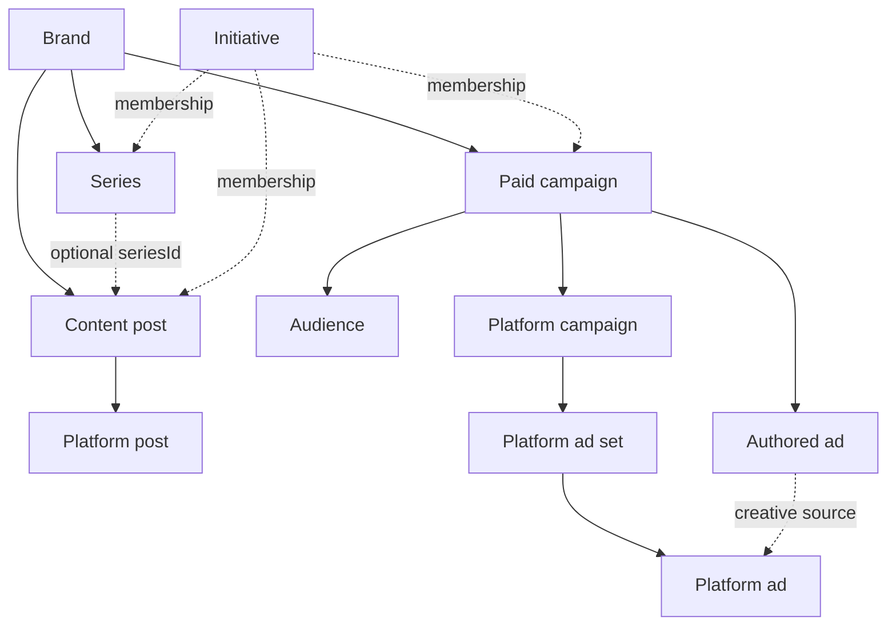

# Initiatives

An Initiative is a workspace-owned grouping for a shared growth push. It can have
an optional lead brand, owner, brief, status and date range. Work from multiple
brands in the same workspace can participate. Brand ownership does not change.

`initiative_member` has a required `initiative_id` and exactly one of
`content_post_id`, `series_id`, `campaign_id`. All targets have real foreign keys
with cascading deletion of membership rows. Unique pairs prevent duplicate links;
an item can belong to multiple initiatives. App and MCP writes validate the
initiative, target brand, lead brand and owner against the active workspace.

Linking a Series includes its current and future posts by query. Direct and
series-inherited posts are deduplicated. Unlinking a direct post does not remove
its inherited membership through a linked Series. Unlinking a Series removes
inherited posts from the view while preserving separately linked posts.

Series and content posts no longer reference Campaign. Campaign is the paid
plan; Initiative is the optional shared context. Draft is an authored record's
status, rather than a separate provider execution object.

The UI is `/app/initiatives`. The same typed service actions are exposed as
`initiativeRead__list`, `initiativeRead__get`, `initiativeRead__options`,
`initiativeWrite__save`, `initiativeWrite__link`, `initiativeWrite__unlink`.
No action publishes content or launches paid delivery.

The production release schema hook runs `scripts/migrate-initiatives.ts` in a
transaction before Drizzle's schema diff. Existing organic Campaign associations
are converted to typed memberships, preserving their paired paid campaign; then
the legacy columns are dropped. Replay is safe and preserves subsequent operator edits. Historical VRMA
bootstrap inserts have been removed so releases cannot recreate unlinked work. The original records, media,
platform drafts and amplification asks remain intact.

PGlite integration tests run the actual migration in an isolated PostgreSQL
engine, covering constraints, preservation, deduplication and rollback. Never
apply the migration to a database of unknown environment for local testing.
