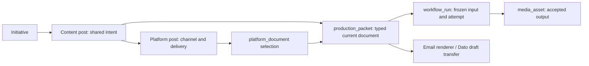

# Shared creative documents

Creative work is owned by `production_packet`, with optional `content_post_id`.
`platform_document` selects one primary document for a platform post. Multiple
platform posts may select a shared document. A standalone packet remains useful
for ad creative and external-tool handoffs.

The row has ownership, document type, title and timestamps. `document` is typed
JSONB: `{schemaVersion: 1, type, brief, content}`. Runtime Zod validation covers all
writes; the database checks that its type agrees with `document_type`. The schema
version is a format discriminator, **not an edit counter**.

- Brief: purpose, audience, direction, verified facts and source URLs, constraints,
  CTA, and media references with roles.
- Article: title, description, slug, Markdown, byline, hero, review findings and
  Dato reference. Pulled Dato blocks are retained until prose is deliberately changed.
- Email: the existing subject, preheader, Markdown, template, product evidence and
  structured property digest. Existing email rendering and audience/send rules remain.
- Image: composition, overlay copy, avoid instructions, aspect ratio, mode and output.
- Video: script, scene IDs, timing, narration, overlay copy, source assets, transitions,
  audio direction and selected output. Production currently writes the plan; it does
  not render video footage.

## One current document, one active run

No revision table, optimistic conflict counter, external edit detection or merging.
Saving replaces the current document. Preparing a brief does not enqueue a job.
Production freezes the saved input on a run and locks document edits and transfers.
The unique partial index permits one queued/running run per packet. Backend row
locks serialize saves and run creation. Cancelled, failed and expired runs release
editing. A late result cannot replace the document. Previous good content survives
failed generation. Attempts keep diagnostics and provider receipts; they are not
an editorial revision browser.

Runs expire after 20 minutes, recovered on the next read/write. Provider calls already
in flight may still charge after cancellation. Dato transfers cannot be cancelled
once dispatched. Retry generation is an explicit new attempt, never automatic.

Article production reuses the lab's storyboard, writing, revision, metadata and
editorial checks without writing lab artifact files. The production format supports native headings, lists, quotations and links, plus
small Markdown tables and standalone library images mapped to the existing Dato
`table` and `blog_image` models. Table cells contain plain text; links belong outside
tables. Quick answers, trade-offs and itineraries use ordinary headings and lists.
The writer avoids custom cards, galleries, embeds and MDX. Export validates the whole
body before uploads and rejects unsupported markup instead of silently dropping it.
Inline image URLs must match ready media in the same brand. Existing pulled Dato
blocks remain intact until the prose is rewritten. Review findings
remain visible and Dato push is an explicit separate draft-only operation. Push and
pull overwrite; publishing still occurs in the CMS.

Image acceptance saves to the media library and shared content pool. Selecting the
finished document on a channel copies its chosen asset into that platform post;
repeat selection explicitly to use a newer asset. Normal small social posts need
no creative document.
